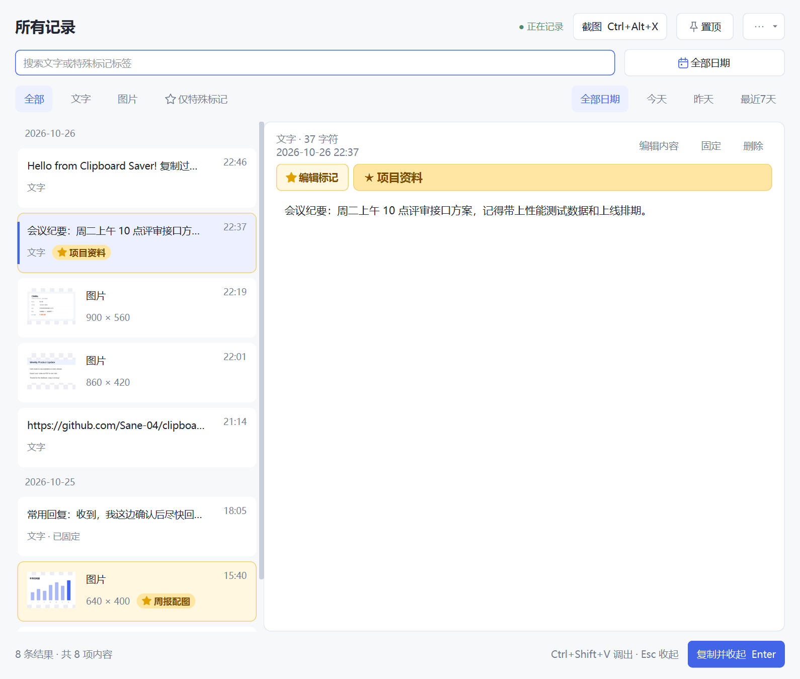
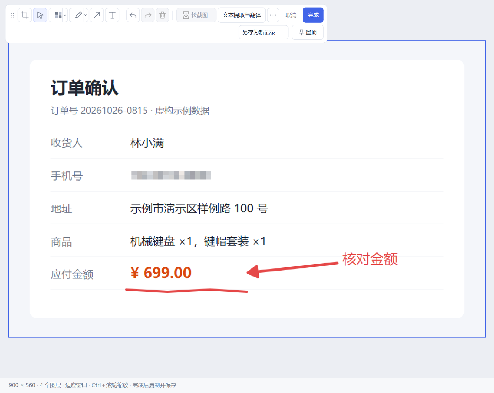
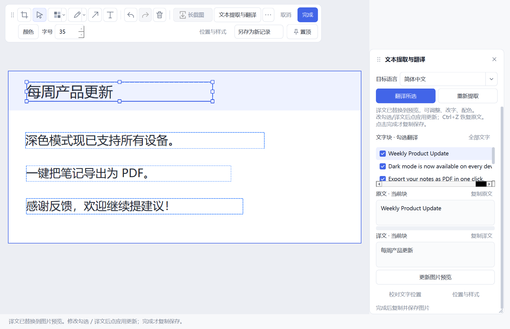

# 剪贴收藏 Clipboard Saver

Windows 剪贴板历史工具。自动记下你复制过的文字和图片，随时找回再粘贴；还自带截图标注、滚动长截图和图片文字识别/翻译。所有数据只保存在本机。

<p align="center"></p>

## 安装

到 [Releases](https://github.com/Sane-04/clipboard-saver/releases/latest) 下载 `ClipboardSaver-<版本>-Setup-x64.exe`，双击安装即可（Windows 10/11 x64，无需管理员权限）。

- 不想安装：下载 `ClipboardSaver-<版本>-Windows-x64.zip`，解压后运行 `剪贴收藏.exe`。
- 如果 Windows 提示「已保护你的电脑」，点「更多信息 → 仍要运行」。安装包没有代码签名，可以用 Release 里的 SHA256 核对文件。

## 使用

| 操作 | 方法 |
| --- | --- |
| 找回复制过的内容 | `Ctrl+Shift+V` 调出历史，双击或按 `Enter` 复制，再到目标位置 `Ctrl+V` |
| 截图 | `Ctrl+Alt+X` 框选，标注或打码后按 `Ctrl+Enter` 复制并保存 |
| 滚动长截图 | `Ctrl+Alt+L` 框选区域，手动慢慢向下滚动，程序自动拼接 |
| 识别/翻译图片文字 | 选中一张图片，点「文本提取与翻译」 |
| 标记重要内容 | 选中记录，点「特殊标记」，可以加一个标签，之后能搜索或只看标记项 |

关闭窗口只是收到托盘，程序会继续记录。要完全退出，右键托盘图标选「退出剪贴收藏」。

| 截图标注：打码、箭头、文字 | 识别图片文字并翻译回图片 |
| --- | --- |
|  |  |

截图中的内容均为虚构示例。

## 配置

都在主窗口右上角的「更多（···）」菜单里：

| 菜单项 | 说明 |
| --- | --- |
| 文字识别与 API 设置 | 翻译需要填一个 OpenAI 兼容接口的 Base URL、API Key 和模型。文字识别默认在本机完成，不需要配置；也可以改用 API 识别 |
| 快捷键设置 | 修改上面这些快捷键 |
| 历史保留设置 | 最多保留多少条记录，默认 1000 条；固定和特殊标记的记录不计入 |
| 数据保存位置 | 历史、图片、模型、备份默认放在程序目录的 `data/` 里，可以改到其他地方 |
| 登录 Windows 后自动启动 | 开机后自动在托盘运行 |

API Key 用 Windows DPAPI 加密保存。默认只有你点「翻译」时，才会把识别出的文字发给接口；只有改用 API 识别时，才会上传图片。

## 开发

需要 Python 3.12：

```powershell
pip install -r requirements.txt
python app.py                  # 从源码运行
python -m pytest -q            # 运行测试（需先 pip install pytest）
```

打包便携版和安装包见 `packaging/build_portable.py --help`；生成安装包需要 [Inno Setup 6](https://jrsoftware.org/isinfo.php)。

## 许可证

[MIT](LICENSE)
